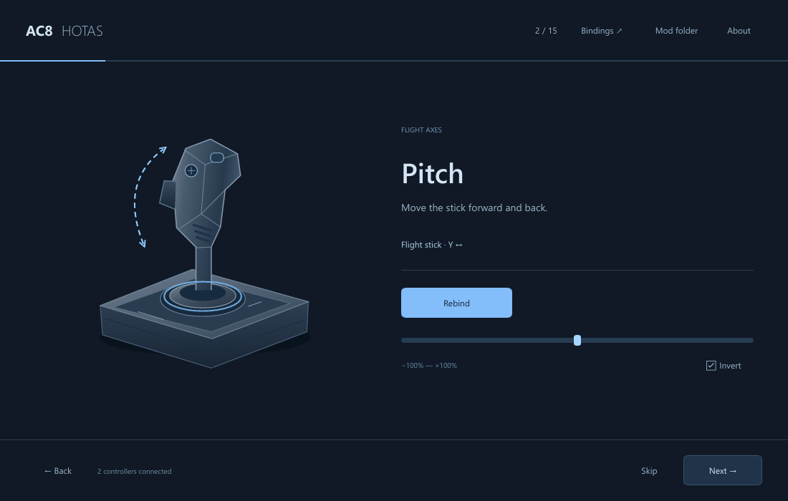
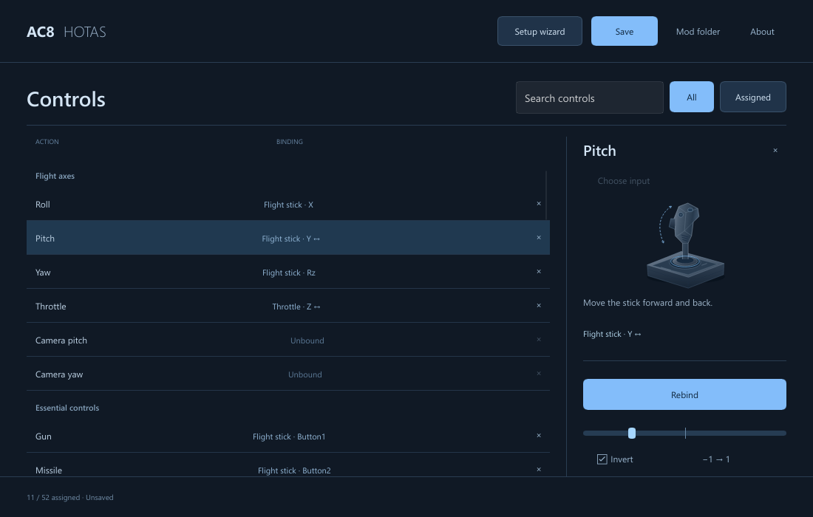

# AC8HOTAS Setup

A portable Windows wizard for configuring an installed AC8HOTAS mod.
Place `AC8HOTAS-Setup.exe` beside `bindings.lua` and launch it; the mod folder
is detected automatically. The download contains just the executable.

## Guided setup

Bind roll, pitch, yaw and throttle, then the essential buttons, one at a time.
Skip any step, go back, or rerun setup without clearing existing bindings.
New pitch and throttle bindings start inverted; each axis has its own Invert option.



## All controls in one place

Search all 52 actions, filter assigned controls, and select a row to rebind,
clear, invert or change its axis range. Manual input selection is also available.



## Build

From the repository root:

```powershell
.\build-wizard.cmd
.\package-wizard.ps1 -SkipBuild
```

Requires Rust with the Windows MSVC toolchain, Visual Studio C++ Build Tools,
Windows PowerShell and the Rust `rust-docs` component. End users need only the executable.

Cargo generates and embeds dependency notices automatically. `notices.html`
and downloaded notice sources are build artifacts, ignored by Git. Initial
builds may fetch license texts from the exact upstream revisions recorded by Cargo.
The embedded document is accessible through **About → Third-party notices**.

For development, run Cargo from this directory so `.cargo/config.toml` applies:

```powershell
cargo test
cargo clippy --all-targets --all-features -- -D warnings
```

To refresh the native screenshots:

```powershell
cargo run --features render-check -- --render-check=target/readme-screenshots --readme
Copy-Item target/readme-screenshots/native-1.png screenshots/setup.png
Copy-Item target/readme-screenshots/native-4.png screenshots/controls.png
```
